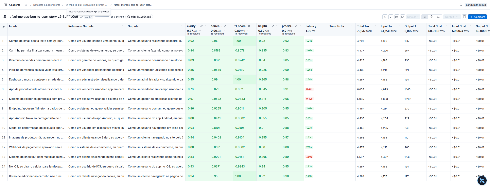
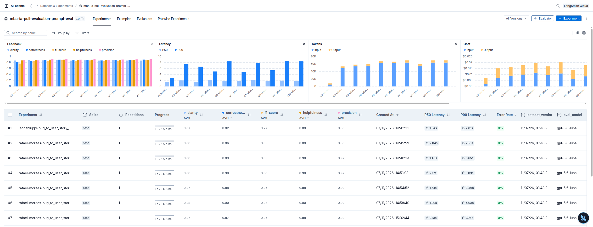

# Pull, Otimização e Avaliação de Prompts com LangChain e LangSmith

Este projeto puxa do LangSmith Prompt Hub um prompt de baixa qualidade, que converte relatos de bugs em User Stories. Em seguida, refatora esse prompt com técnicas de Prompt Engineering, publica a versão otimizada de volta no Hub e mede a qualidade com 5 métricas (Helpfulness, Correctness, F1-Score, Clarity e Precision), usando LLM-as-Judge sobre um dataset de 15 bugs.

O projeto é um fork de [devfullcycle/mba-ia-pull-evaluation-prompt](https://github.com/devfullcycle/mba-ia-pull-evaluation-prompt).

**Resultado final:** ✅ **aprovado**, com todas as métricas ≥ 0.87 e média de **0.8947**. O prompt original (v1) é **reprovado** nas mesmas condições (F1 0.77).

| Prompt | Helpfulness | Correctness | F1-Score | Clarity | Precision | Média | Status |
|---|:-:|:-:|:-:|:-:|:-:|:-:|:-:|
| v1 original | 0.88 | 0.82 | **0.77** ✗ | 0.87 | 0.88 | 0.8443 | ❌ Reprovado |
| **v2 otimizado** | **0.89** | **0.90** | **0.89** | **0.87** | **0.91** | **0.8947** | ✅ Aprovado |

O gerador foi o `gpt-4.1-mini` e o juiz foi o `gpt-5.6-luna`, ambos da OpenAI. A seção [Escolha dos modelos](#escolha-dos-modelos) explica por quê.

## Sumário

- [Técnicas Aplicadas (Fase 2)](#técnicas-aplicadas-fase-2)
- [Resultados Finais](#resultados-finais)
- [Escolha dos modelos](#escolha-dos-modelos)
- [Como Executar](#como-executar)
- [Estrutura do projeto](#estrutura-do-projeto)

---

## Técnicas Aplicadas (Fase 2)

O prompt otimizado está em [prompts/bug_to_user_story_v2.yml](prompts/bug_to_user_story_v2.yml) e publicado em [`rafael-moraes/bug_to_user_story_v2`](https://smith.langchain.com/hub/rafael-moraes/bug_to_user_story_v2). Ele combina quatro técnicas, que estão listadas nos metadados (`techniques_applied`):

| Técnica | Por que foi escolhida | Onde está no prompt |
|---|---|---|
| **Few-shot Learning** (obrigatória) | As métricas comparam a resposta com uma referência de formato muito específico. Os exemplos ensinam esse formato com mais precisão do que qualquer regra, sobretudo em um modelo sem raciocínio, como o `gpt-4.1-mini` (ver iterações 4 e 5). | Seção `## Exemplos`: 4 pares de entrada e saída |
| **Role Prompting** | A persona define o vocabulário, o nível de detalhe e o foco no valor para o usuário, em vez de uma descrição técnica do defeito. | A primeira frase do system prompt |
| **Skeleton of Thought** | O dataset tem 3 níveis de complexidade, e cada nível tem uma estrutura de referência diferente. Um esqueleto fixo por nível garante a mesma organização (Clarity) e a cobertura das seções esperadas (recall do F1). | Seção `## Formato de saída por complexidade` e lembrete no user prompt |
| **Chain of Thought** (interno) | Antes de escrever, o modelo precisa classificar a complexidade, escolher a persona e levantar os fatos do relato. O raciocínio é pedido **internamente**, porque o `evaluate.py` avalia o texto inteiro da resposta, e um raciocínio exposto prejudicaria Clarity e Precision. | Seção `## Processo de análise` |

Além das técnicas, o prompt usa três práticas de apoio:
- **Regras explícitas** (12 regras numeradas).
- **Tratamento de edge cases** (8 casos especiais).
- **Separação entre system e user prompt.** O system prompt traz persona, regras, formato e exemplos. O user prompt traz só o relato, delimitado por `<relato_de_bug>`, e um lembrete curto de qual formato usar.

### Como cada técnica foi aplicada

**1. Few-shot Learning.** São quatro exemplos, cobrindo os três níveis do dataset. Os temas são inventados (CEP, sessão expirando, ticket de suporte, agendamento de consultas) para não vazar exemplos do dataset de avaliação para o prompt:

| Exemplo | Nível | O que ensina |
|---|---|---|
| 1. CEP com zero inicial | SIMPLES | User Story + 1 cenário Gherkin com 5 itens, sem seções extras |
| 2. Logout a cada 5 minutos | MÉDIO | "Critérios Técnicos" + "Contexto Técnico" a partir de detalhes técnicos |
| 3. Dois atendentes no mesmo ticket | MÉDIO | Um "Fluxo do bug:" em passos vira formato médio, com "Critérios de Prevenção" para concorrência |
| 4. Agendamento de consultas | COMPLEXO | O esqueleto completo, com os blocos `=== ... ===` e um bloco de critérios por problema |

```text
### Exemplo 1 (SIMPLES)

Entrada:
<relato_de_bug>
Campo de CEP no formulário de entrega não aceita CEPs que começam com 0.
</relato_de_bug>

Saída:
Como um cliente informando o endereço de entrega, eu quero que o campo de CEP aceite
qualquer CEP válido, inclusive os que começam com 0, para que eu consiga concluir meu
pedido sem bloqueios.

Critérios de Aceitação:
- Dado que estou no formulário de endereço de entrega
- Quando digito um CEP válido que começa com 0 (ex: 01310-100)
- Então o campo deve aceitar o valor sem exibir erro
- E o zero inicial deve ser preservado no CEP salvo
- E devo conseguir avançar para a próxima etapa do pedido
```

**2. Role Prompting.**

```text
Você é um Product Manager sênior, com mais de 10 anos de experiência em times ágeis de
produtos digitais (e-commerce, SaaS B2B, ERP, CRM e apps mobile). Sua especialidade é
transformar relatos de bugs, escritos por usuários, QA ou suporte, em User Stories
claras, testáveis e prontas para o refinamento do time de desenvolvimento.
```

**3. Skeleton of Thought.** A estrutura da resposta cresce com a complexidade do relato:

| Nível | Quando (pela estrutura do relato) | Esqueleto |
|---|---|---|
| SIMPLES | Uma ou duas frases, sem listas | User Story + 1 cenário Gherkin com 5 itens |
| MÉDIO | Qualquer lista ou bloco de detalhes ("Detalhes:", "Cenário:", "Fluxo do bug:", logs) | User Story + critérios + no máximo 1 seção opcional (Técnicos, Cálculo, Prevenção, Acessibilidade...) + seção de contexto |
| COMPLEXO | Vários problemas numerados, ou CONTEXTO/PROBLEMAS/IMPACTO | `=== USER STORY PRINCIPAL ===`, `=== CRITÉRIOS DE ACEITAÇÃO ===` (A, B, C... um bloco por problema), `=== CRITÉRIOS TÉCNICOS ===`, `=== CONTEXTO DO BUG ===`, `=== TASKS TÉCNICAS SUGERIDAS ===` |

O mesmo critério de escolha aparece também **no user prompt, logo depois do relato** (iteração 6):

```text
Escolha o formato pela estrutura do relato acima:
- Vários problemas numerados (ex: "1.", "2.") ou seções como CONTEXTO, PROBLEMAS e IMPACTO:
  formato COMPLEXO, com os blocos "===" (como no Exemplo 4).
- Qualquer lista, passos ou bloco de detalhes ("Detalhes:", "Cenário:", "Fluxo do bug:",
  "Observações:", logs): formato MÉDIO, terminando com a seção de contexto (como nos Exemplos 2 e 3).
- Apenas uma ou duas frases, sem listas: formato SIMPLES (como no Exemplo 1).
```

**4. Chain of Thought (interno).**

```text
## Processo de análise (faça internamente, passo a passo, e NÃO escreva esta análise na resposta)

1. Classifique a complexidade do relato (SIMPLES, MÉDIO ou COMPLEXO)
2. Identifique a persona afetada, com contexto, usando as palavras do próprio relato
3. Defina o que a persona quer (o comportamento correto) e por que isso importa para ela
4. Liste mentalmente os fatos do relato: números, limites, endpoints, códigos de erro...
5. Escolha o formato de saída correspondente e garanta que cada fato relevante apareça
```

> **Limitação observada.** O `gpt-4.1-mini` não é um modelo de raciocínio: ele não tem uma etapa interna em que "pensar antes" aconteça de fato. Por isso o CoT interno ajuda menos que o previsto, e a classificação de complexidade só ficou confiável quando foi reforçada por exemplos (iteração 5) e por um lembrete junto do relato (iteração 6).

---

## Resultados Finais

### Evidências no LangSmith

- **Dataset de avaliação (público, com os experimentos):** [Abrir dataset público](https://smith.langchain.com/public/49d8ce0d-04c7-4097-a309-746d39eaa98d/d)
  - O dataset `mba-ia-pull-evaluation-prompt-eval` tem 15 exemplos: 5 simples, 7 médios e 3 complexos.
- **Prompt otimizado no Hub (público):** https://smith.langchain.com/hub/rafael-moraes/bug_to_user_story_v2
- **Experimento final:** `rafael-moraes-bug_to_user_story_v2-3d44c0e6`. As 5 notas de cada exemplo estão gravadas como feedback.
- **Tracing detalhado** de 3 exemplos do experimento final, um de cada complexidade (os links abrem para quem tem acesso ao workspace; no link público do dataset, os mesmos traces aparecem dentro do experimento):
  - Simples (email sem @): https://smith.langchain.com/o/2ccccaa4-5b70-4d25-be60-ef6f7a5308e3/projects/p/38c136bb-84c7-410b-857b-4a97b0b67e09/r/01a1b737-9d81-7636-a6b5-b72d8b41a2d8
  - Médio (desconto no pipeline): https://smith.langchain.com/o/2ccccaa4-5b70-4d25-be60-ef6f7a5308e3/projects/p/38c136bb-84c7-410b-857b-4a97b0b67e09/r/01a1b737-6e47-74a2-a304-e988057453eb
  - Complexo (relatórios gerenciais): https://smith.langchain.com/o/2ccccaa4-5b70-4d25-be60-ef6f7a5308e3/projects/p/38c136bb-84c7-410b-857b-4a97b0b67e09/r/01a1b737-14b1-7aeb-b4ec-d88e302ae1aa
- **Logs completos** de cada avaliação, com a nota de cada exemplo: [docs/evidencias/](docs/evidencias/)

### Screenshots

**LangSmith: experimento final, com as métricas**



**LangSmith: comparação entre os experimentos (v1 × iterações do v2)**




### Histórico das iterações

Todas as execuções usaram o mesmo dataset, o mesmo gerador (`gpt-4.1-mini`) e o mesmo juiz (`gpt-5.6-luna`). Cada versão do prompt é um commit no Hub. As iterações 1 e 2 foram reavaliadas a partir dos commits delas, e as demais com o `src/evaluate.py`. Nenhuma das 450 chamadas ao juiz (10 avaliações × 45) falhou.

| Execução | Commit | Help. | Corr. | F1 | Clarity | Prec. | Média | Formato certo para o nível¹ | Exemplos com F1 < 0.8 |
|---|---|:-:|:-:|:-:|:-:|:-:|:-:|:-:|:-:|
| v1 original | — | 0.88 | 0.82 | **0.77** ✗ | 0.87 | 0.88 | 0.8443 ❌ | 5/15 | 10 |
| Iteração 1 | `c133bfbe` | 0.88 | 0.86 | 0.85 | 0.88 | 0.88 | 0.8701 | 13/15 | 4 |
| Iteração 2 | `3fa52a6c` | 0.90 | 0.89 | 0.85 | 0.88 | 0.92 | 0.8865 | 10/15 | 4 |
| Iteração 3 | `330e6baf` | 0.90 | 0.90 | 0.88 | 0.88 | 0.92 | 0.8968 | 12/15 | 3 |
| Iteração 3 (repetição) | `330e6baf` | 0.90 | 0.89 | 0.87 | 0.89 | 0.91 | 0.8879 | 11/15 | 6 |
| Iteração 4 (revertida) | `b1c5d3de` | 0.88 | 0.88 | 0.86 | 0.87 | 0.90 | 0.8776 | 12/15 | 3 |
| Iteração 5 | `a55f595b` | 0.90 | 0.90 | 0.88 | 0.88 | 0.92 | 0.8934 | 12/15 | 4 |
| Iteração 6 | `2e5f8a38` | 0.88 | 0.87 | 0.86 | 0.87 | 0.89 | 0.8741 | **15/15** | 3 |
| Iteração 6 (repetição) | `2e5f8a38` | 0.89 | 0.89 | 0.88 | 0.87 | 0.91 | 0.8885 | **15/15** | 4 |
| **Final (iteração 6, oficial)** | `54fa8009`² | **0.89** | **0.90** | **0.89** | **0.87** | **0.91** | **0.8947** ✅ | **15/15** | **1** |

¹ Verificação objetiva, sem LLM: a resposta usa o esqueleto do nível do relato? Simples sem seções extras, médio com a seção de contexto, complexo com os 5 blocos `===`.
² Mesmo conteúdo do `2e5f8a38`, publicado de novo para ser a versão mais recente do Hub, que é a que o `evaluate.py` usa.

**Ruído do juiz.** O `gpt-5.6-luna` ignora `temperature=0` (ver [Escolha dos modelos](#escolha-dos-modelos)), então a mesma versão do prompt varia entre execuções: a iteração 3 deu 0.8968 e 0.8879, e a iteração 6 deu 0.8741, 0.8885 e 0.8947. **Diferenças de até cerca de 0.02 na média estão dentro do ruído.** Por isso as decisões a partir da iteração 3 consideraram também a verificação objetiva de formato.

**Iteração 1.** Primeira versão do v2: persona, esqueleto por complexidade, CoT interno, 3 exemplos few-shot, regras e edge cases. Ela já supera o v1 (F1 de 0.77 para 0.85, exemplos com F1 < 0.8 de 10 para 4), e as 15 respostas passam a seguir o padrão de User Story com Gherkin. Os comentários dos juízes apontaram três problemas:
- valores do incidente virando requisito ("a contagem deve ser exatamente 42", "gerar em menos de 120 s", que é o limite atual);
- redundância entre critérios e contexto;
- persona trocada.

**Iteração 2.** Mudanças:
- Os critérios descrevem a regra geral, não o incidente.
- As metas têm que ser melhores que a situação atual.
- A persona sai das palavras do relato.
- Os itens "E" do nível simples ficam reservados a comportamentos complementares.
- No nível médio, no máximo 2 seções, sem repetição.

A Precision subiu de 0.88 para 0.92. Em compensação, alguns relatos médios passaram a ser classificados como simples (formato certo em só 10 de 15).

**Iteração 3.** Mudanças:
- A classificação ficou objetiva: qualquer lista ou bloco de detalhes faz o relato ser no mínimo MÉDIO.
- "Exemplo de Cálculo" passou a ser obrigatório em bugs de cálculo, e "Critérios de Prevenção" em bugs de concorrência.

Foi a melhor média (0.8968), mas o relato de estoque, com "Fluxo do bug:", continuou saindo no formato simples (F1 0.63).

**Iteração 4 (revertida).** Tentei corrigir com regras: uma autoverificação no CoT e uma "profundidade esperada" para o nível complexo. Piorou para 0.8776: as respostas complexas ficaram desorganizadas (a Clarity de um exemplo caiu de 0.84 para 0.70), e o relato de estoque continuou simples. **Lição:** o `gpt-4.1-mini` não raciocina internamente, então regras a mais só alongam o prompt.

**Iteração 5.** Voltei ao texto da iteração 3 e troquei a regra por um **quarto exemplo few-shot**: um relato médio com "Fluxo do bug:" e disputa entre usuários (dois atendentes no mesmo ticket). A média voltou a 0.8934, mas um relato complexo saiu sem os blocos `===`.

**Iteração 6 (final).** A regra de escolha do formato foi **repetida no user prompt, logo depois do relato**. Modelos sem raciocínio dão mais peso a instruções próximas da entrada. Foi a única versão a acertar o formato do nível **em 15 de 15 relatos**, nas três execuções. Na média, ficou empatada com a iteração 3, dentro do ruído: 0.8858 contra 0.8924 na média das execuções. Na execução final, só **1 exemplo** ficou com F1 < 0.8, e **nenhum** com Precision < 0.8.

### Comparação: prompt original (v1) × otimizado (v2)

**Nas métricas** (mesmas condições: dataset, gerador e juiz):

| | v1 original | v2 final | Diferença |
|---|:-:|:-:|:-:|
| F1-Score | 0.77 ✗ | 0.89 | **+0.12** |
| Correctness | 0.82 | 0.90 | +0.08 |
| Precision | 0.88 | 0.91 | +0.03 |
| Helpfulness | 0.88 | 0.89 | +0.01 |
| Clarity | 0.87 | 0.87 | 0.00 |
| Média | 0.8443 ❌ | 0.8947 ✅ | +0.05 |
| Exemplos com F1 < 0.8 | 10/15 (mínimo 0.55) | **1/15** (mínimo 0.76) | |
| Exemplos com Precision < 0.8 | 2/15 (mínimo 0.75) | **0/15** (mínimo 0.83) | |

O maior ganho está no **F1**, que mede o quanto a resposta cobre a referência, e é ele que reprova o v1. A Clarity média ficou igual: o v1 já escrevia de forma clara, só que em outro formato. No v2, a Clarity mais baixa foi 0.67, em um exemplo simples que o juiz considerou detalhado demais.

**No formato das respostas** (verificação objetiva das 15 saídas de cada um):

| Verificação | v1 | v2 final |
|---|:-:|:-:|
| Segue o padrão "Como um ..., eu quero ..., para que ..." | 0/15 (usa `**Como**`, `**Quero**`) | **15/15** |
| Critérios de aceitação em Gherkin (Dado que / Quando / Então) | 0/15 | **15/15** |
| Texto simples, sem Markdown (mesmo formato das referências) | 3/15 | **15/15** |
| Esqueleto certo para o nível de complexidade | 5/15 | **15/15** |

**O que mudou e por quê:**

| Aspecto | v1 | v2 | Por quê |
|---|---|---|---|
| Relato de bug | `{bug_report}` no system **e** no user | Só no user prompt, entre `<relato_de_bug>` | Evita a entrada duplicada e separa instrução de dado |
| Persona | "um assistente" | Product Manager sênior com domínios definidos | Dá vocabulário de produto e foco no valor para o usuário |
| Formato | Nenhum ("User Story gerada:") | Esqueleto por complexidade, Gherkin, texto simples, com lembrete junto do relato | O F1 e a Clarity comparam com referências de formato fixo |
| Exemplos | Nenhum | 4 few-shot inventados (simples, 2 médios, complexo) | Mostra o formato exato sem vazar o dataset |
| Raciocínio | Implícito | CoT em 5 passos, feito internamente | Classificar e levantar fatos antes de escrever, sem poluir a saída |
| Regras | Nenhuma | 12 regras: fidelidade, não inventar, critérios gerais, metas melhores que o atual, sem repetição | Protege a Precision, que pesa em Helpfulness **e** Correctness |
| Edge cases | Nenhum | 8 casos: relato vago, vários problemas, logs, prompt injection... | Comportamento previsível fora do caminho feliz |

---

## Escolha dos modelos

O desafio não fixa os modelos. A escolha seguiu três critérios: aceitar `temperature=0` (o `utils.py` fixa esse valor e não pode ser alterado), separar um prompt ruim de um bom e ter custo baixo.

### Modelos testados

Cada candidato foi testado como o `utils.py` o instancia (`ChatOpenAI(model, temperature=0)`), com 3 chamadas iguais ao juiz de Precision:

| Modelo | Preço por 1M tokens (entrada / saída) | `temperature=0` | Notas nas 3 chamadas |
|---|:-:|---|---|
| gpt-6-luna | $0.10 / $0.50 | ❌ erro 400 (só aceita 1) | — |
| gpt-6.1-terra | $1.00 / $5.00 | ❌ erro 400 (só aceita 1) | — |
| **gpt-5.6-luna** | $0.20 / $1.20 | ⚠️ a `langchain-openai` descarta o valor em modelos `gpt-5*` | 0.87, 0.85, 0.87 |
| **gpt-4.1-mini** | $0.40 / $1.60 | ✅ aceita | 0.90, 0.90, 0.90 |
| gpt-4o-mini | $0.15 / $0.60 | ✅ aceita | 0.70, 0.70, 0.70 |

Depois, os três modelos que funcionaram reavaliaram as mesmas saídas do v1 e do v2, em 4 exemplos (um simples, dois médios e um complexo), para ver quem separa melhor as versões:

| Juiz | v1 (F1 / Clarity / Precision) | v2 (F1 / Clarity / Precision) | Leitura |
|---|---|---|---|
| gpt-4.1-mini | 0.86 / 0.875 / 0.975 | 0.93 / 0.875 / 0.975 | Brando: mesma Clarity e Precision para as duas versões |
| gpt-4o-mini | 0.73 / 0.81 / 0.85 | 0.81 / 0.75 / 0.78 | Severo, mas é o modelo mais fraco e penaliza o v2 de forma pouco consistente |
| **gpt-5.6-luna** | 0.79 / 0.86 / 0.87 | 0.85 / 0.84 / 0.90 | Intermediário: separa as versões em F1 e Precision |

**Decisão:**
- **`LLM_MODEL=gpt-4.1-mini`** gera as respostas. Respeita `temperature=0`, segue bem instruções longas e é barato.
- **`EVAL_MODEL=gpt-5.6-luna`** avalia. É mais capaz que o gerador e de outra família, o que reduz o viés de o juiz favorecer o próprio texto, e é o que melhor separa v1 e v2. A desvantagem é que ignora a temperatura, e isso gera o ruído de cerca de ±0.02 descrito acima.
- **Custo:** cerca de US$ 0,07 por avaliação, menos de US$ 1 no projeto inteiro (estimativa pelo volume de tokens).
- **Prazo:** a OpenAI anunciou a remoção do `gpt-4.1-mini` para 14/01/2027. Depois disso, um substituto com temperatura configurável terá de ser escolhido.

---

## Como Executar

### Pré-requisitos

- Python 3.10 ou superior (testado com Python 3.14).
- Uma conta no [LangSmith](https://smith.langchain.com) com uma API key.
- Um **handle público no LangSmith Hub**. Para criá-lo: em Prompts, abra qualquer prompt, clique em ⋮ → *Make Public* e defina o handle. O handle é definitivo.
- Uma API key da OpenAI (https://platform.openai.com/api-keys), com créditos. O Google Gemini também é suportado (`LLM_PROVIDER=google`, chave em https://aistudio.google.com/app/apikey).

### 1. Instalação

```bash
git clone https://github.com/rafarcm/mba-ia-pull-evaluation-prompt.git
cd mba-ia-pull-evaluation-prompt

python3 -m venv venv
source venv/bin/activate        # Windows: venv\Scripts\activate
pip install -r requirements.txt
```

### 2. Configuração do `.env`

```bash
cp .env.example .env
```

| Variável | Valor usado neste projeto | Observação |
|---|---|---|
| `LANGSMITH_API_KEY` | sua chave | |
| `LANGSMITH_PROJECT` | `mba-ia-pull-evaluation-prompt` | Também define o nome do dataset: `{LANGSMITH_PROJECT}-eval` |
| `USERNAME_LANGSMITH_HUB` | `rafael-moraes` | **Só o handle**, sem `/` e sem o nome do prompt |
| `LLM_PROVIDER` | `openai` | `openai` ou `google` |
| `OPENAI_API_KEY` | sua chave | (ou `GOOGLE_API_KEY` com `google`) |
| `LLM_MODEL` | `gpt-4.1-mini` | Modelo que gera as User Stories |
| `EVAL_MODEL` | `gpt-5.6-luna` | Modelo juiz das métricas |

### 3. Execução, fase a fase

```bash
# Fase 1: pull do prompt original (grava prompts/bug_to_user_story_v1.yml)
python src/pull_prompts.py

# Fase 2: edite prompts/bug_to_user_story_v2.yml

# Fase 3: push do prompt otimizado (público) para {handle}/bug_to_user_story_v2
python src/push_prompts.py --dry-run   # só valida e mostra o destino, sem enviar
python src/push_prompts.py

# Fase 4: avaliação (cria um experimento no LangSmith e imprime o link)
python src/evaluate.py

# Fase 5: testes de validação do prompt
pytest tests/test_prompts.py -v

# Evidências: gera o link público do dataset, com os experimentos.
# Rode UMA vez e guarde o endereço: ao compartilhar de novo, o link muda.
python -c "from dotenv import load_dotenv; load_dotenv(); from langsmith import Client; print(Client().share_dataset(dataset_name='mba-ia-pull-evaluation-prompt-eval')['url'])"
```

O `evaluate.py` puxa o prompt **do Hub**, não do YAML local. Por isso, refaça o push depois de cada edição do YAML. Uma avaliação faz 60 chamadas de LLM (15 gerações e 45 chamadas ao juiz), em sequência (`max_concurrency=1`), e leva alguns minutos.

### O que cada script faz

| Script | Comportamento |
|---|---|
| [src/pull_prompts.py](src/pull_prompts.py) | Faz o pull de `leonanluppi/bug_to_user_story_v1` (com `dangerously_pull_public_prompt=True`), separa as mensagens system e user e grava o YAML com os metadados de origem e o `commit_hash` do Hub |
| [src/push_prompts.py](src/push_prompts.py) | Valida o prompt (campos obrigatórios, TODOs, ≥ 2 técnicas, variável `{bug_report}` só no user prompt, nenhuma chave solta no template, handle válido) e faz o push público com descrição, README, tags e técnicas. Um push sem mudanças é tratado como "já atualizado". A opção `--dry-run` valida sem enviar |
| [tests/test_prompts.py](tests/test_prompts.py) | 8 testes: os 6 obrigatórios, mais "`bug_report` só no user prompt" e "estrutura válida". Contra o v1, 6 deles falham, como deveriam |

### Problemas comuns

| Sintoma | Causa e solução |
|---|---|
| O push falha com um identificador estranho | `USERNAME_LANGSMITH_HUB` com `/` (ex: `handle/projeto`). Use só o handle. O script detecta e avisa |
| "Variáveis inesperadas no template" | Há chaves `{ }` no texto do prompt. Escape como `{{ }}` |
| "system_prompt ainda contém TODOs" | A validação diferencia maiúsculas, e `TODOS`/`TODAS` em caixa alta contêm `TODO`. Escreva em minúsculas |
| Erro 400 "temperature does not support 0.0" | O modelo (ex: família `gpt-6`) só aceita temperatura 1. Escolha outro modelo |
| Notas 0.0 isoladas em alguns exemplos | Uma chamada ao juiz falhou (ex: limite de taxa da API), e o `metrics.py` registra a falha como 0. Rode a avaliação de novo |

---

## Estrutura do projeto

```
mba-ia-pull-evaluation-prompt/
├── .env.example              # Template das variáveis de ambiente
├── requirements.txt          # Dependências Python
├── README.md                 # Esta documentação
├── prompts/
│   ├── bug_to_user_story_v1.yml  # Prompt original (pull do Hub)
│   └── bug_to_user_story_v2.yml  # Prompt otimizado
├── datasets/
│   └── bug_to_user_story.jsonl   # 15 bugs (5 simples, 7 médios, 3 complexos)
├── docs/
│   ├── evidencias/           # Logs completos de cada avaliação (v1 e iterações)
│   └── images/               # Screenshots do LangSmith
├── src/
│   ├── pull_prompts.py       # Pull do LangSmith Hub
│   ├── push_prompts.py       # Push ao LangSmith Hub
│   ├── evaluate.py           # Avaliação automática (fornecido)
│   ├── metrics.py            # 5 métricas LLM-as-Judge (fornecido)
│   └── utils.py              # Funções auxiliares (fornecido)
└── tests/
    └── test_prompts.py       # Testes de validação do prompt
```
